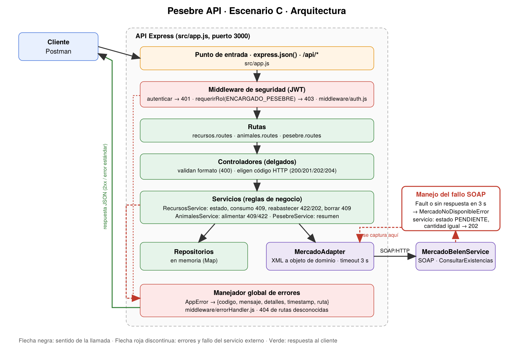

# API de gestión de recursos del pesebre

Escenario resuelto: **C**.

API REST en Node.js (Express) que administra los recursos del pesebre de Belén y a sus animales. Para reabastecer consulta el servicio SOAP heredado `MercadoBelenService` a través de un adaptador y sigue respondiendo cuando ese servicio falla. Incluye el extra `GET /api/pesebre/resumen`.

## Cómo levantar el proyecto

Requiere Node.js 20 o superior.

```bash
npm install
cp .env.example .env
npm start
```

La API queda en `http://localhost:3000`. Los datos se guardan en memoria.

Servicio SOAP: la API lo consume en la URL definida en `MERCADO_SOAP_URL`.

- Con el mock del docente: poner su endpoint en `MERCADO_SOAP_URL` dentro de `.env`.
- Con el mock local incluido: `npm run mock` en otra terminal (escucha en `http://localhost:4000/mercado`). Cantidad `999` devuelve el `soap:Fault` "Mercado cerrado", `998` no responde (prueba del timeout), mayor a `100` devuelve `SIN_EXISTENCIAS` y cualquier otra `DISPONIBLE`.

Pruebas automáticas: `npm test` (levantan su propio mock y su propia API).

## Variables de entorno

| Variable             | Descripción                                           | Valor en `.env.example`             |
| -------------------- | ----------------------------------------------------- | ----------------------------------- |
| `PORT`               | Puerto de la API                                      | `3000`                              |
| `JWT_SECRET`         | Secreto para firmar y verificar los JWT               | `cambia-este-secreto-en-tu-entorno` |
| `MERCADO_SOAP_URL`   | Endpoint del servicio SOAP                            | `http://localhost:4000/mercado`     |
| `MERCADO_TIMEOUT_MS` | Tiempo máximo de espera al SOAP                       | `3000`                              |
| `APP_TIMEZONE`       | Zona horaria para decidir "el mismo día" al alimentar | `America/Guayaquil`                 |

El archivo `.env` no se versiona (está en `.gitignore`). Solo se incluye `.env.example`.

## Usuarios y tokens de prueba

La autenticación usa JWT (HS256) en el header `Authorization: Bearer <token>`. El rol va en el claim `rol`.

| Rol                                  | Acceso                                                                        |
| ------------------------------------ | ----------------------------------------------------------------------------- |
| `ENCARGADO_PESEBRE`                  | Crear, consumir, reabastecer y eliminar recursos                              |
| `PASTOR`, `PAJE`, `ELFO`, `AYUDANTE` | Token válido, pero reciben 403 en los endpoints de recursos que requieren rol |

Sin token, los endpoints protegidos responden 401.

Tokens de prueba:

- `postman/pesebre.postman_environment.json` incluye los tokens `tokenEncargado` (`ENCARGADO_PESEBRE`) y `tokenPastor` (`PASTOR`), firmados con el `JWT_SECRET` de `.env.example`. Funcionan con `.env` copiado de `.env.example` sin modificar.
- Con otro `JWT_SECRET`, `npm run tokens` imprime un token por cada rol, firmado con el secreto de `.env`.

## Endpoints

| Método | Ruta                                  | Respuestas                                | Acceso            |
| ------ | ------------------------------------- | ----------------------------------------- | ----------------- |
| POST   | `/api/recursos`                       | 201, 400, 401, 403, 409 (nombre repetido) | ENCARGADO_PESEBRE |
| GET    | `/api/recursos?categoria=&estado=`    | 200, 400                                  | pública           |
| GET    | `/api/recursos/{id}`                  | 200, 404                                  | pública           |
| PATCH  | `/api/recursos/{id}/consumo`          | 200, 400, 401, 403, 404, 409              | ENCARGADO_PESEBRE |
| PATCH  | `/api/recursos/{id}/reabastecimiento` | 200, 202, 400, 401, 403, 404, 422         | ENCARGADO_PESEBRE |
| DELETE | `/api/recursos/{id}`                  | 204, 401, 403, 404, 409                   | ENCARGADO_PESEBRE |
| POST   | `/api/animales`                       | 201, 400                                  | pública           |
| GET    | `/api/animales?especie=`              | 200, 400                                  | pública           |
| PATCH  | `/api/animales/{id}/alimentacion`     | 200, 404, 409, 422                        | pública           |
| GET    | `/api/pesebre/resumen` (extra)        | 200                                       | pública           |

Todas las respuestas de error usan la misma estructura:

```json
{
  "codigo": "STOCK_INSUFICIENTE",
  "mensaje": "Quedan 4 unidades y se piden 5",
  "detalles": [],
  "timestamp": "2026-12-01T10:15:00.000Z",
  "ruta": "/api/recursos/{id}/consumo"
}
```

Reglas de negocio implementadas:

- El estado del recurso lo calcula el sistema en cada cambio de cantidad: `0` es `AGOTADO`, menor que `stockMinimo` es `BAJO_STOCK` y en otro caso `DISPONIBLE`.
- Un consumo que deje la cantidad en negativo responde 409.
- Alimentar descuenta la `racionDiaria` del recurso de categoría `ALIMENTO_ANIMALES`. Si no alcanza (o no hay ninguno registrado) responde 409 y no descuenta nada.
- Un animal no se alimenta dos veces el mismo día (422). El día se calcula en `APP_TIMEZONE`.
- Reabastecer consulta el SOAP: `SIN_EXISTENCIAS` responde 422, `DISPONIBLE` suma la cantidad pedida.
- No se elimina un recurso con cantidad mayor a 0 (409).
- Consumo y reabastecimiento exigen `cantidad` entera mayor o igual a 1.

## Arquitectura



Fuente editable: [`docs/arquitectura.svg`](docs/arquitectura.svg).

Una petición recorre las capas **rutas → controladores → servicios → repositorios**:

| Capa           | Carpeta                           | Responsabilidad                                                     |
| -------------- | --------------------------------- | ------------------------------------------------------------------- |
| Entrada        | `src/app.js`                      | Arma las dependencias, registra las rutas y el manejador de errores |
| Seguridad      | `src/middleware/auth.js`          | Verifica el JWT (401) y el rol (403)                                |
| Rutas          | `src/routes`                      | Asocian método y URL con un controlador y aplican la seguridad      |
| Controladores  | `src/controllers`                 | Validan el formato de la entrada (400) y eligen el código HTTP      |
| Servicios      | `src/services`                    | Contienen todas las reglas de negocio                               |
| Repositorios   | `src/repositories`                | Almacenamiento en memoria                                           |
| Adaptador SOAP | `src/adapters/mercado.adapter.js` | Traduce XML a objeto de dominio; es el único código que conoce XML  |
| Errores        | `src/middleware/errorHandler.js`  | Manejador global con el formato único de error                      |

### Fallo del servicio SOAP

El adaptador convierte un `soap:Fault`, una espera mayor a 3 segundos, un error de red o una respuesta ilegible en un `MercadoNoDisponibleError`. `RecursosService.reabastecer` lo captura, deja el recurso en `REABASTECIMIENTO_PENDIENTE` sin modificar la cantidad y el controlador responde 202 Accepted indicando que el reabastecimiento se confirmará después. El fallo del servicio externo no produce respuestas 500.

## Colección de Postman

Archivos en `postman/`: `pesebre.postman_collection.json` y `pesebre.postman_environment.json`.

Cubre 200/201, 400, 401, 403, 404, 409, 422 y el SOAP caído (202), con aserciones en cada petición. Para ejecutarla completa, iniciar la API (y el mock SOAP) sin datos previos y correrla en orden:

```bash
npx newman run postman/pesebre.postman_collection.json -e postman/pesebre.postman_environment.json
```

## Si el Polo Norte separara el sistema en microservicios

Separaría dos servicios. **Pesebre** es dueño de los recursos y los animales: su estado, consumos y alimentaciones, con su propia base de datos. **Abastecimiento** es dueño de los pedidos al Mercado de Belén: guarda cada pedido (categoría, cantidad, estado) y es el único que habla con el SOAP. Pesebre no lee las tablas de Abastecimiento; le envía una solicitud y recibe el resultado por evento.

Si Abastecimiento cae el 24 a las 23:00, Pesebre sigue funcionando porque consumir y alimentar solo usan sus propios datos. Reabastecer responde 202, el recurso queda en REABASTECIMIENTO_PENDIENTE y la cantidad no cambia, igual que hoy cuando falla el SOAP. Al volver, el pedido pendiente se reintenta. El riesgo real es que el alimento se agote mientras tanto y alimentar responda 409, así que conviene un stockMinimo alto antes de esa noche.
